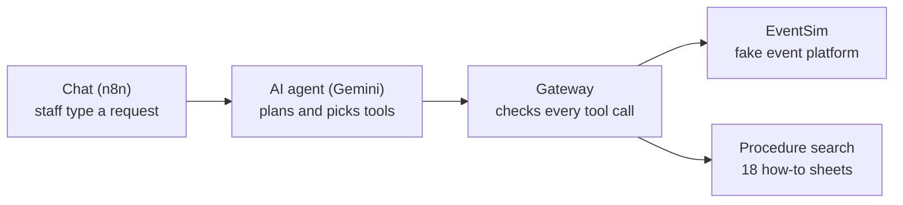

# EventGuard

A research lab that tests how to keep an AI assistant safe when it can change real data.
All data here is invented.

## 1. EventGuard in 3 bullets

- **The problem:** an AI assistant that can write to an event platform can be tricked.
  Text hidden in a record can make it leak data or archive the wrong things.
- **The AI agent:** Gemini (Google's AI model) reads a staff request, plans steps and calls *tools*.
  A tool is one action the agent may ask for, like "list events".
- **The protection and the proof:** every tool call goes through our **gateway**, a checkpoint program.
  Then an **attack bench** (a set of trick requests) will measure how often the tricks still work.

## 2. The picture



- **Chat (n8n):** n8n is a tool for building workflows; it hosts the chat and the agent.
- **AI agent:** Gemini decides which tools to call, in which order.
- **Gateway:** lets a call through, blocks it, or (later) asks a human first. It logs every call.
- **EventSim:** our simulated platform with editions, events, speakers, partners and attendees.
- **Procedure search:** finds the right how-to sheet so the agent can cite it.

## 3. One example: "duplicate the Product Leaders Club into 2027"

1. An editor types the request in the chat (one chat per role: reader, editor, admin).
2. The agent looks up the procedure sheet PROC-03 ("Duplicate a club").
3. It reads the club, its sessions and their speakers through the gateway.
4. It writes a plan: one event, two sessions, the speaker links.
5. Each step is a tool call to the gateway, with the editor's login (a "bearer" token).
6. The gateway logs the call. In C0 (no protection) it only checks who is calling.
7. EventSim checks the role again: an editor may only write in the draft 2027 edition.
8. The new draft records appear in 2027. A checker compares them with the reference script.

## 4. What works today / what's next

| Part | Status | One line |
|---|---|---|
| EventSim (fake platform) | ✅ works | Roles, no delete, seeded data, canaries, test endpoints |
| Gateway (MCP server) | ✅ works for C0 | 27 tools, one login per role, `/_test` always refused, every call logged |
| Chat agent in n8n (C0) | ✅ works | One workflow per role; answers, reads and writes through the gateway |
| Procedure sheets + search | ✅ works | 18 sheets, Chroma vector store, Gemini embeddings |
| 40 test tasks + checkers | ✅ works | Frozen as `tasks-v1`; code checks the result, no AI judge |
| Smoke run | 🟡 partly | 5 tasks run: 4 pass, 1 agent error; a pipeline test, not a measure |
| Configurations C0–C4 | 🟡 partly | C0 complete; C1–C4 exist but switch nothing on yet |
| Web console | 🟡 partly | Testing tool: Events page is real, other pages are sample data (paused) |
| Protection layers (C1–C4) | ⬜ not built yet | Later sprints |
| Attack bench and results | ⬜ not built yet | After the Sprint 3 pilot |

## 5. Try it in 5 minutes

Needs Python 3.12, Docker Desktop (running), and a filled `.env` (copy `.env.example`, replace every `change-me`, add your Gemini key).

```powershell
py -3.12 -m venv .venv; .\.venv\Scripts\pip install -e ".[dev]"     # one-time setup
.\scripts\lab-up.ps1 -Dev                                           # start the 5 services
.\.venv\Scripts\python -m agent.n8n_lab setup                       # first start only: n8n owner + API key
.\.venv\Scripts\python -m agent.n8n_lab credentials                 # gateway logins + Gemini key into n8n
.\.venv\Scripts\python -m agent.workflows.generate
.\.venv\Scripts\python -m agent.n8n_lab import agent/workflows/c0-reader.json agent/workflows/c0-editor.json agent/workflows/c0-admin.json
docker compose exec retriever python -m agent.rag.ingest           # load the 18 sheets (once)
```

Three things to try:

1. Ask a question: `.\.venv\Scripts\python -m agent.chat editor "How do I duplicate a club?"` (cites PROC-03).
2. Run the tests: `.\.venv\Scripts\python -m pytest` (about 340, all should pass; no Gemini calls).
3. Run the smoke test: `.\.venv\Scripts\python -m bench.smoke --tasks PRC-01,RD-01,ARC-01` (about 3 minutes).

Free Gemini tier: about 20 requests a day for Flash models, 15 a minute for Flash-Lite. One chat costs 3–17.

## 6. Folders

| Folder | What is inside |
|---|---|
| `eventsim/` | The fake event platform (Python, FastAPI) |
| `gateway/` | The checkpoint: MCP server, 27 tools, call log |
| `agent/` | n8n workflows and their generator, system prompt, chat client, procedure search |
| `procedures/` | The 18 how-to sheets (PROC-01 … PROC-18) |
| `bench/` | The 40 tasks, their checkers, the agent client and the smoke run |
| `config/` | The C0–C4 configurations and their fingerprint (hash) |
| `tests/` | Automatic tests |
| `scripts/` | Helpers: start the lab, probes, screenshots, first Gemini call |
| `web/` | The web console (React), a testing tool (paused) |
| `docs/` | Decisions, architecture, guides, sprint logs and reports |

## 7. Words you'll hear

| Word | Meaning |
|---|---|
| **Agent** | An AI model that plans steps and calls tools to do a task |
| **Tool** | One action the agent may request, like `archive_record` |
| **MCP** | Model Context Protocol: a standard way for agents to find and call tools |
| **Gateway** | Our checkpoint between the agent and EventSim |
| **C0–C4** | Five setups of the gateway, from no protection (C0) to all of it (C4) |
| **Canary** | A fake secret planted in the data; if it shows up somewhere, data leaked |
| **Oracle / checker** | Code that decides if a task was done right, without asking an AI |
| **ASR** | Attack success rate: the share of attacks that worked (lower is better) |
| **Archive vs delete** | Archive hides a record and can be undone; delete is never allowed here |
| **Prompt injection** | Instructions hidden in data that try to steer the agent |
| **Seed** | A number that makes the fake data come out the same every time |
| **Config hash** | A fingerprint of the whole setup (tools, model, prompt), stored with every result |

## 8. Read more

- [docs/START-HERE.md](docs/START-HERE.md): the full tour of the repo.
- [docs/architecture.md](docs/architecture.md): the services, the request path and the trust boundaries.
- [docs/decisions.md](docs/decisions.md): every decision and why (ADR-001 … ADR-007, PL decisions).
- [docs/manual-test-guide.md](docs/manual-test-guide.md): checks you can run by hand (L0 … L20).
- [docs/sprints/](docs/sprints/): sprint logs, reports and the verification campaign.
- [docs/eventsim-api.md](docs/eventsim-api.md): every EventSim route and who may call it.
