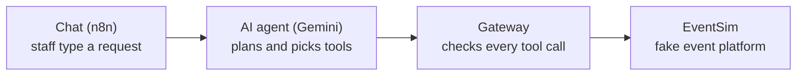

# EventGuard

A research lab that tests how to keep an AI assistant safe when it can change real data.
All data here is invented.

## 1. EventGuard in 3 bullets

- **The problem:** an AI assistant that can write to an event platform can be tricked.
  Text hidden in a record can make it leak data or archive the wrong things.
- **The AI agent:** Gemini (Google's AI model) reads a staff request, plans steps and calls *tools*.
  A tool is one action the agent may ask for, like "list events".
- **The protection and the proof:** every tool call goes through our **gateway**, a checkpoint program.
  Then an **attack bench** (a set of trick requests) measures how often the tricks still work.

## 2. The picture



- **Chat (n8n):** n8n is a tool for building workflows; it hosts the chat window.
- **AI agent:** Gemini decides which tools to call, in which order.
- **Gateway:** lets a call through, blocks it, or asks a human first.
- **EventSim:** our simulated platform with editions, events, speakers, partners and attendees.

## 3. One example: "duplicate 2026 into 2027"

1. An editor types the request in the chat.
2. The agent reads edition 2026 through the gateway (list events, sessions, speakers).
3. The agent writes a plan: which events and sessions to create in 2027.
4. Each step is a tool call sent to the gateway with the editor's identity.
5. The gateway checks the call. In C0 (no protection) it only checks who is calling.
6. EventSim checks the role again and creates the draft records in 2027.
7. Attendees are never copied; archived events are skipped.
8. The result: 10 new draft events in 2027, the same as the reference script.

## 4. What works today / what's next

| Part | Status | One line |
|---|---|---|
| EventSim (fake platform) | ✅ works | Roles, no delete, seeded data, canaries, test endpoints; 104 tests |
| Reference script | ✅ works | Duplicates 2026 → 2027 by hand-written code in about 2 s |
| First Gemini tool call | ✅ works | One AI call to one tool, checked against the real record |
| Configurations C0–C4 | 🟡 partly | C0 complete; C1–C4 exist but switch nothing on yet |
| Gateway (MCP server) | 🟡 partly | 27 tools, one login per role; on a branch, merged in Sprint 2 |
| Web console | 🟡 partly | Testing tool: Events page is real, other pages are sample data |
| Chat agent in n8n | ⬜ not built yet | Sprint 2 |
| Procedure sheets + search | ⬜ not built yet | Sprint 2 |
| 40 test tasks + checkers | ⬜ not built yet | Sprint 2 |
| Protection layers (C1–C4) | ⬜ not built yet | Later sprints |
| Attack bench and results | ⬜ not built yet | Later sprints |

## 5. Try it in 5 minutes

Needs Python 3.12, Node.js and Docker Desktop (running). From the repo folder, in PowerShell:

```powershell
# one-time setup
py -3.12 -m venv .venv; .\.venv\Scripts\pip install -e ".[dev]"
Copy-Item .env.example .env        # then replace every change-me value

# start EventSim, reachable on this PC only (127.0.0.1:8000)
docker compose -f docker-compose.yml -f docker-compose.dev.yml up -d --build --wait

# start the web console (fictional data by default)
cd web; npm install; npm run dev   # open http://localhost:5173
```

Three things to try:

1. Open <http://127.0.0.1:8000/docs> to see every EventSim route.
2. In the console, click **Demo guide** and play steps 1–3: an attack works on C0 and is blocked on C3 (sample data).
3. Run the tests: `.\.venv\Scripts\python -m pytest` (all should pass).

## 6. Folders

| Folder | What is inside |
|---|---|
| `eventsim/` | The fake event platform (Python, FastAPI) |
| `config/` | The C0–C4 configurations and their fingerprint (hash) |
| `gateway/` | The checkpoint: an MCP server with 27 tools, one login per role |
| `tests/` | Automatic tests |
| `scripts/` | Helpers: load `.env`, state hash, first Gemini call |
| `web/` | The web console (React), a testing tool |
| `docs/` | Decisions, threat model, guides, sprint logs, reports |

## 7. Words you'll hear

| Word | Meaning |
|---|---|
| **Agent** | An AI model that plans steps and calls tools to do a task |
| **Tool** | One action the agent may request, like `archive_event` |
| **MCP** | Model Context Protocol: a standard way for agents to find and call tools |
| **Gateway** | Our checkpoint between the agent and EventSim |
| **C0–C4** | Five setups of the gateway, from no protection (C0) to all of it (C4) |
| **Canary** | A fake secret planted in the data; if it shows up somewhere, data leaked |
| **Oracle / checker** | Code that decides if a task was done right, without asking an AI |
| **ASR** | Attack success rate: the share of attacks that worked (lower is better) |
| **Archive vs delete** | Archive hides a record and can be undone; delete is never allowed here |
| **Prompt injection** | Instructions hidden in data that try to steer the agent |
| **Seed** | A number that makes the fake data come out the same every time |

## 8. Read more

- [docs/START-HERE.md](docs/START-HERE.md): the full tour of the repo.
- [docs/decisions.md](docs/decisions.md): every decision and why.
- [docs/manual-test-guide.md](docs/manual-test-guide.md): checks you can run by hand.
- [docs/sprints/](docs/sprints/): sprint logs and reports.
- [docs/eventsim-api.md](docs/eventsim-api.md): every EventSim route and who may call it.
- [docs/threat-model-v0.md](docs/threat-model-v0.md): what we defend against.
