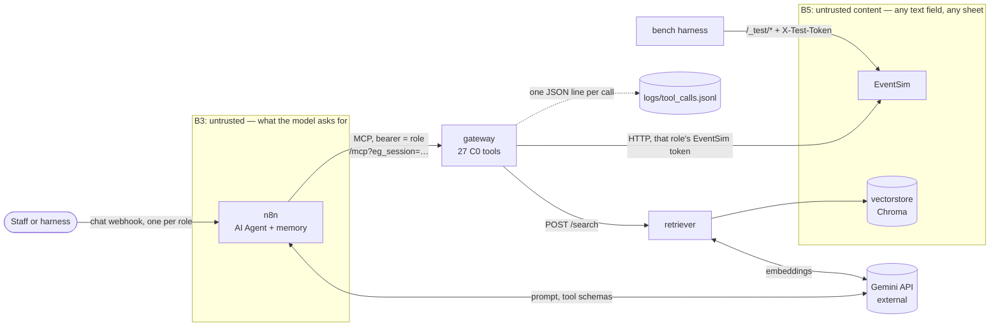

# Architecture

What runs today, how one request travels, and where the trust boundaries are. Configuration **C0** only: the gateway checks identity and the `/_test` deny rule, nothing else yet.

## 1. Services (docker-compose.yml)

| Service | What it is | Networks | Host port | Secrets it holds |
|---|---|---|---|---|
| `eventsim` | The simulated event platform (FastAPI) | `lab_internal` | none (dev override: `127.0.0.1:8000` for the harness) | EventSim user tokens, test token |
| `gateway` | MCP server, the only path from the agent to EventSim | `lab_internal` | **none, ever** | gateway bearer per role, EventSim user tokens |
| `retriever` | Embeds queries, searches the vector store | `lab_internal`, `egress` | none | Gemini API key |
| `vectorstore` | Chroma 1.5.9 with the procedure-sheet chunks | `lab_internal` | none | — |
| `n8n` | Chat + AI Agent (Gemini) + MCP Client Tool | `lab_internal`, `egress` | `127.0.0.1:5678` | gateway bearer per role and Gemini key, as encrypted n8n credentials |

`lab_internal` has no route to the internet or the host. `egress` gives internet access to n8n (chat model) and the retriever (embeddings) only. The gateway never holds the Gemini key or the test token.

## 2. The request path

**Example: "Duplicate the club Product Leaders Club into edition 2027" (as editor).**

1. The harness or a person posts the message to the editor workflow's chat webhook, with a session id.
2. n8n's AI Agent sends the message, the system prompt and the 27 tool schemas to Gemini.
3. Gemini asks for tools. n8n calls them on the gateway with the **editor** bearer, and the session id in the URL.
4. The gateway maps the bearer to the EventSim editor user, runs the (empty, C0) layer pipeline, and calls EventSim with the editor's token only.
5. `search_procedures` goes to the retriever, which embeds the query (Gemini) and asks Chroma. Hits come back marked `source: procedure_sheet`.
6. EventSim enforces the role matrix (PL decision #2): the editor may create in the draft 2027 edition only.
7. Each tool call is one line in `logs/tool_calls.jsonl` (session, role, config hash, tool, arguments, outcome, latency).
8. The agent answers; n8n stores the execution (tokens per model call), exported by `agent/export_runs.py`.

## 3. Trust boundaries (from `docs/threat-model-v0.md`)

| Boundary | Where it is now | What enforces it today (C0) |
|---|---|---|
| B1 human → n8n | chat webhook on `127.0.0.1:5678` | loopback only; no user login on the chat |
| B2 n8n → Gemini | `egress` network | API key in n8n credentials |
| B3 agent → gateway | MCP on `lab_internal` | bearer per role (401 otherwise); `/_test` deny rule; nothing else in C0 |
| B4 gateway → EventSim | HTTP on `lab_internal` | per-user EventSim token; EventSim's role matrix |
| B5 EventSim / sheets → agent | tool results | **nothing in C0** (spotlighting and output filter are C3) |
| B6 harness → `/_test/*` | dev override port, `X-Test-Token` | separate token; refused to every user token; unreachable from the gateway |

## 4. Identity and correlation (ADR-005)

- **Identity:** one gateway bearer per role, one n8n workflow per role. No per-person identity.
- **Correlation:** the chat session id travels in the MCP URL (`eg_session`) and is logged by the gateway. It is a label, not an identity.

## 5. Reproducibility (NFR-02)

Every log line and result carries the config name and **config hash**: SHA-256 of the resolved configuration, which includes the tool list, layer flags, model name, temperature, max tokens, retrieval settings and the system prompt's SHA-256. Plus the git commit and, for smoke results, the model version actually served (`agent/model_probe.py`).
